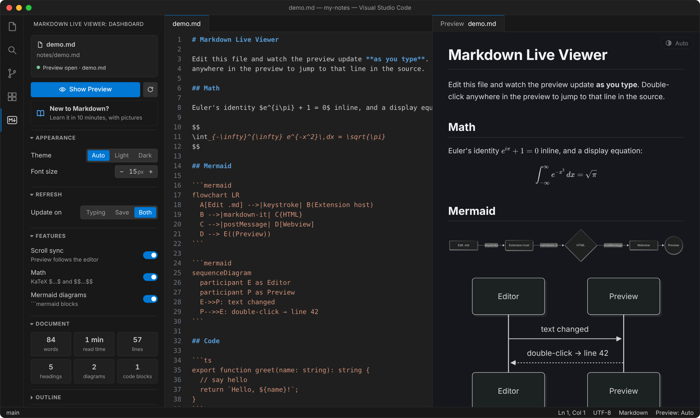
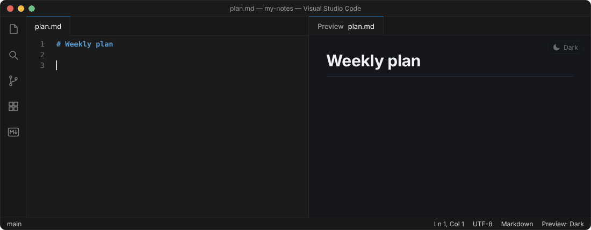
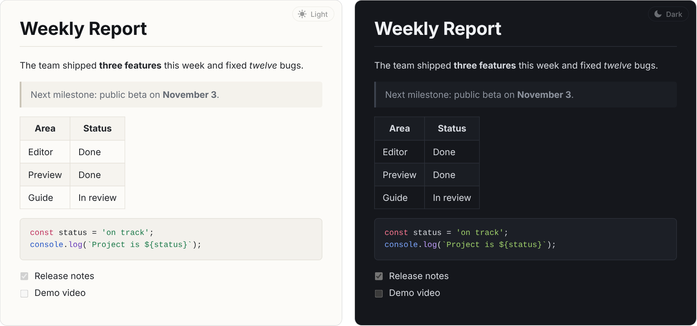
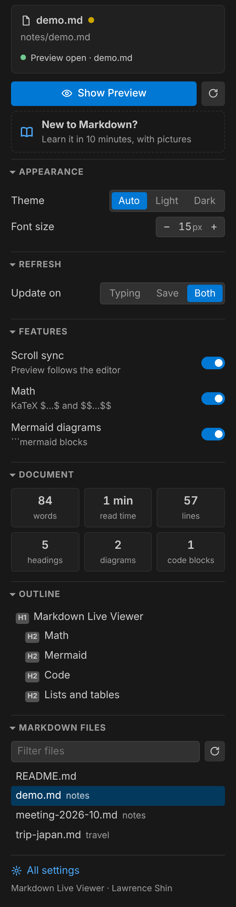
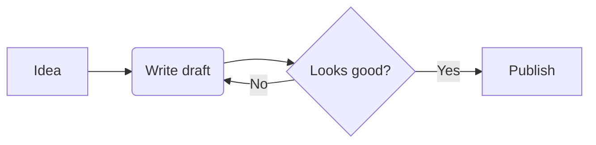
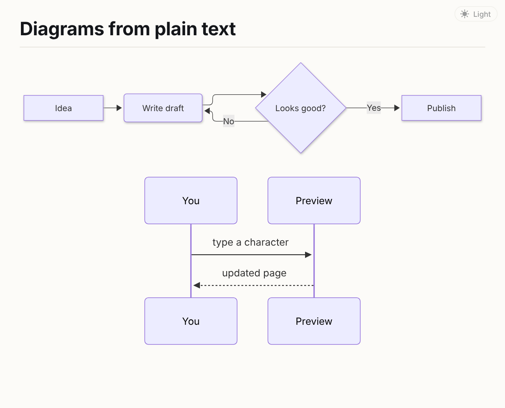
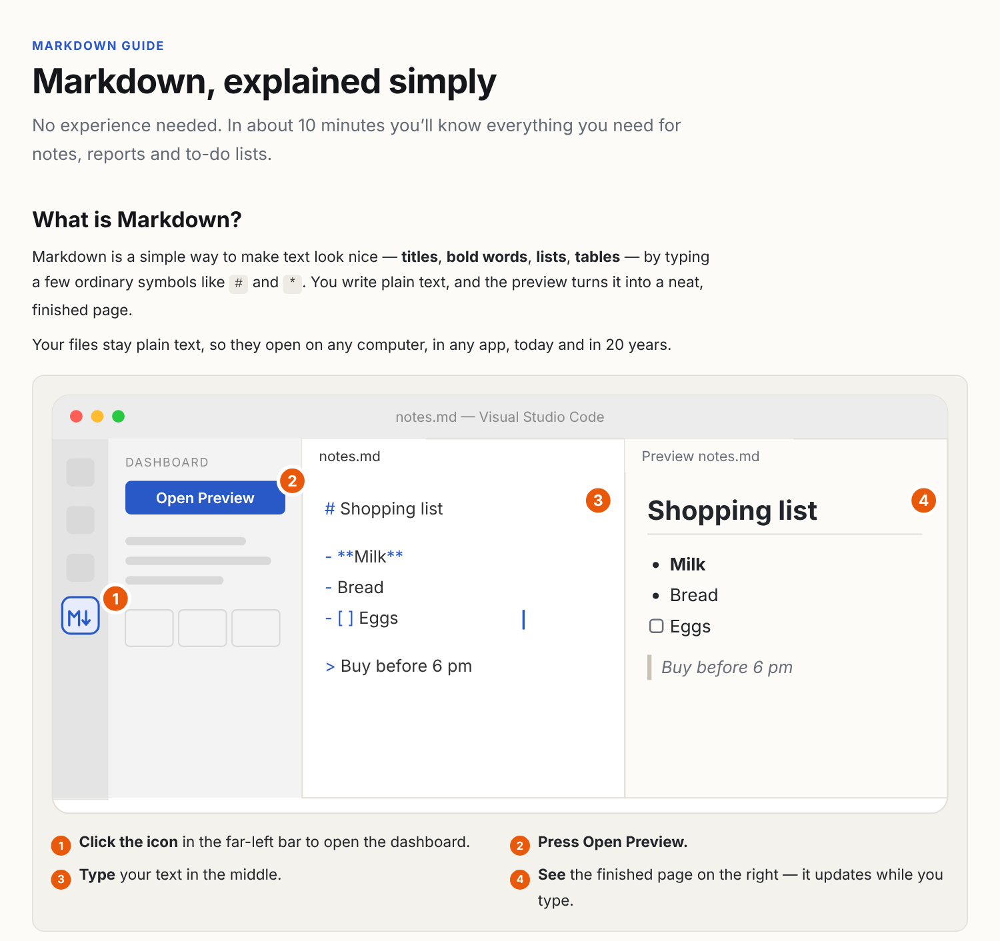
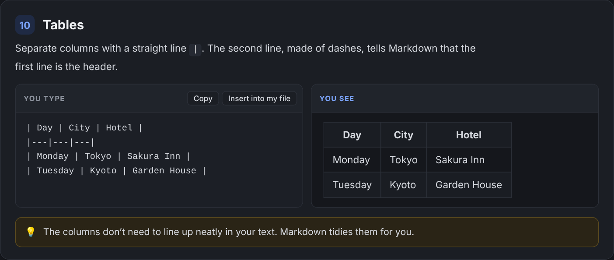

# Markdown Live Viewer

**See your Markdown as a finished page while you type — with light and dark modes, diagrams, math, and a friendly guide for people who have never used Markdown before.**

[](https://marketplace.visualstudio.com/items?itemName=lawrenceshin.md-live-viewer)
[](https://marketplace.visualstudio.com/items?itemName=lawrenceshin.md-live-viewer)
[](LICENSE)



Inspired by LaTeX Workshop's PDF viewer: your text on one side, the result on the other, always up to date.

---

## Contents

- [Highlights](#highlights)
- [Install](#install)
- [Quick start (2 minutes)](#quick-start-2-minutes)
- [Using the preview](#using-the-preview)
- [The sidebar dashboard](#the-sidebar-dashboard)
- [Diagrams](#diagrams)
- [Math formulas](#math-formulas)
- [New to Markdown? The beginner guide](#new-to-markdown-the-beginner-guide)
- [Settings](#settings)
- [Commands and keyboard shortcut](#commands-and-keyboard-shortcut)
- [Questions and troubleshooting](#questions-and-troubleshooting)
- [For developers](#for-developers)

---

## Highlights

- **Updates as you type.** No saving, no refresh button. The page changes in place, so it never flickers or jumps.
- **Light, Dark or Auto.** One click switches the preview's colours. Auto follows your VS Code theme.
- **Its own sidebar.** Click the icon on the left to open a dashboard with every option as a button or switch — no settings files needed.
- **Diagrams from plain text** (Mermaid) and **math formulas** (KaTeX).
- **Jump to source.** Double-click anything in the preview to go straight to that line in your text.
- **Built-in beginner guide** with pictures, side-by-side examples and a practice area.
- Works **offline**. Nothing you write leaves your computer.

---

## Install

**From the Extensions view (recommended)**

1. In VS Code, click the **Extensions** icon in the left bar (or press <kbd>Ctrl</kbd>+<kbd>Shift</kbd>+<kbd>X</kbd>, <kbd>Cmd</kbd>+<kbd>Shift</kbd>+<kbd>X</kbd> on Mac).
2. Search for **Markdown Live Viewer**.
3. Click **Install**.

**From a .vsix file**

Extensions view → **⋯** menu (top-right) → **Install from VSIX…** → choose the file.

---

## Quick start (2 minutes)

**1. Open or create a Markdown file.**
Any file whose name ends in `.md`, for example `notes.md`. To create one: **File → New File**, then save it as `notes.md`.

**2. Click the Markdown Live Viewer icon** in the far-left bar (the little box with an **M** and an arrow). The dashboard opens.

**3. Press _Open Preview_.** The finished page appears to the right of your text.

**4. Start typing.** The preview follows along by itself.



> **Never used Markdown?** Click **New to Markdown?** at the top of the dashboard. The guide explains everything in about 10 minutes — see [the beginner guide](#new-to-markdown-the-beginner-guide).

---

## Using the preview

### It updates while you type

Every change you make shows up in the preview a fraction of a second later. Saving (<kbd>Ctrl</kbd>+<kbd>S</kbd>) also refreshes it instantly. If you prefer LaTeX-Workshop style (update **only** when you save), set **Update on → Save** in the dashboard.

### Light, Dark or Auto



There are three ways to switch:

| Where | How |
|---|---|
| **The preview itself** | Click the small round button in its top-right corner. It cycles **Auto → Light → Dark**. |
| **The dashboard** | **Appearance → Theme**: Auto / Light / Dark. |
| **The status bar** | Click the theme label at the bottom-right of the window (shown when a Markdown file is open). |

**Auto** matches your VS Code colour theme and changes with it. Your choice is remembered.

### The preview follows your scrolling

When you scroll through your text, the preview scrolls to the same place. You can turn this off with the **Scroll sync** switch in the dashboard.

### Double-click to jump to your text

Double-click any heading, paragraph, list item, table or picture in the preview, and the cursor jumps to that exact line in your text — handy in long documents.

### Pictures, links and more

- **Pictures** next to your file just work: `` looks for `images/photo.png` in the same folder as your `.md` file.
- **Links** to websites open in your browser. Links to other `.md` files open them in the editor, and the preview switches to that file.
- Links to headings in the same page (`[see below](#results)`) scroll the preview.
- Also supported: tables, checklists (`- [ ]`), footnotes, highlighted code for 190+ languages, and plain HTML.

The preview always shows the Markdown file you're working on: switch to another `.md` tab and it follows. When you restart VS Code, it reopens where you left off.

---

## The sidebar dashboard

<table>
<tr>
<td width="290" valign="top"></td>
<td valign="top">

Click the **Markdown Live Viewer** icon in the left bar to open it. From top to bottom:

**Current file** — the name of the file you're working on. An orange dot means it has unsaved changes. A green dot shows whether the preview is open.

**Open / Show Preview** — opens the preview beside your text. The round arrow next to it refreshes the preview.

**New to Markdown?** — opens the beginner guide.

**Appearance** — Theme (Auto / Light / Dark) and font size of the preview.

**Refresh** — when the preview updates: while **Typing**, on **Save**, or **Both**.

**Features** — switches for scroll sync, math formulas and diagrams.

**Document** — words, reading time, lines, headings, diagrams and code blocks in your file.

**Outline** — every heading in your file. Click one to jump there.

**Markdown Files** — every `.md` file in your folder, with a filter box. Click to open.

**All settings** — opens VS Code's settings for this extension.

</td>
</tr>
</table>

The buttons at the top of the sidebar panel (eye, book and gear) are shortcuts for Open Preview, the guide and settings.

---

## Diagrams

Describe a diagram in words and the preview draws it, using [Mermaid](https://mermaid.js.org/). Put the description in a block that starts with ` ```mermaid ` and ends with ` ``` `:

````markdown

````



- `A --> B` draws an arrow from A to B. `[ ]` makes a box, `( )` a rounded box, `{ }` a diamond.
- `LR` means left-to-right; use `TD` for top-down.
- Flowcharts, sequence diagrams, pie charts, timelines, Gantt charts and more all work — see the [Mermaid documentation](https://mermaid.js.org/intro/).

**While you're typing a diagram,** it will often be unfinished. Instead of disappearing, the last working version stays on screen (slightly faded) with a short note explaining the problem underneath. It comes back to full colour as soon as the diagram is complete.

---

## Math formulas

Put a formula between dollar signs, using LaTeX notation (rendered by [KaTeX](https://katex.org/)):

```markdown
The area of a circle is $A = \pi r^2$.

$$
\int_{-\infty}^{\infty} e^{-x^2}\,dx = \sqrt{\pi}
$$
```

One `$` keeps the formula inside the sentence; two `$$` put it on its own line, centred and larger. A typo in a formula shows it in red instead of breaking the page.

---

## New to Markdown? The beginner guide

Most Markdown tools assume you're a programmer. This one doesn't. Open the guide from **New to Markdown?** in the dashboard, or the **book** button at the top of the sidebar.



- **Plain words, no jargon.** What Markdown is, and how to start in three steps — with pictures.
- **14 short lessons:** titles, paragraphs, bold and italic, lists, checklists, links, pictures, quotes, tables, divider lines, exact text, and (optional) diagrams and math.
- **"You type" next to "You see"** in every lesson, with the real result.
- **Copy** and **Insert into my file** buttons, so you never have to retype symbols.
- **Common mistakes** — almost always a missing or extra space — shown wrong ✗ and right ✓.
- A one-screen **cheat sheet**, and a **Try it yourself** box that shows the result as you type.
- **Create a practice file for me** opens a ready-made example with the preview beside it.



---

## Settings

Everything below can be changed from the dashboard. To see them all: dashboard → **All settings**, or **File → Preferences → Settings** and search for `mdViewer`.

| Setting | Default | What it does |
|---|---|---|
| `mdViewer.refreshOn` | `both` | When the preview updates: `type` (while typing), `save` (when you save), or `both`. |
| `mdViewer.typeDelay` | `150` | How long to wait after your last keystroke before updating, in milliseconds. Raise it for very large files. |
| `mdViewer.theme` | `auto` | Preview colours: `auto` (follow VS Code), `light` or `dark`. |
| `mdViewer.scrollSync` | `true` | Preview scrolls along with your text. |
| `mdViewer.math` | `true` | Draw `$…$` and `$$…$$` as math formulas. |
| `mdViewer.mermaid` | `true` | Draw ` ```mermaid ` blocks as diagrams. |
| `mdViewer.fontSize` | `15` | Preview text size in pixels. |
| `mdViewer.customCss` | `""` | Path to your own stylesheet, to restyle the preview. Absolute, or relative to your workspace folder. |

Example (`settings.json`):

```json
{
  "mdViewer.refreshOn": "save",
  "mdViewer.theme": "dark",
  "mdViewer.fontSize": 17
}
```

---

## Commands and keyboard shortcut

Press <kbd>Ctrl</kbd>+<kbd>Shift</kbd>+<kbd>P</kbd> (<kbd>Cmd</kbd>+<kbd>Shift</kbd>+<kbd>P</kbd> on Mac) and type **MD Viewer**:

| Command | Shortcut |
|---|---|
| MD Viewer: Open Preview to the Side | <kbd>Ctrl</kbd>+<kbd>Shift</kbd>+<kbd>Alt</kbd>+<kbd>V</kbd> (Mac: <kbd>Cmd</kbd>+<kbd>Shift</kbd>+<kbd>Alt</kbd>+<kbd>V</kbd>) |
| MD Viewer: Markdown Guide for Beginners | |
| MD Viewer: Toggle Preview Theme (Light / Dark / Auto) | |
| MD Viewer: Refresh Preview | |
| MD Viewer: Rescan Markdown Files | |
| MD Viewer: Open Settings | |

**To change the shortcut:** **File → Preferences → Keyboard Shortcuts**, search for `MD Viewer: Open Preview`, double-click it and press the keys you want.

---

## Questions and troubleshooting

**The preview doesn't update while I type.**
Check **Refresh → Update on** in the dashboard. If it's set to **Save**, the preview only changes when you save.

**My picture doesn't show.**
The path is read from the folder your `.md` file is in. `` needs `photo.png` right next to the file; `` needs it inside an `images` folder there. Check the spelling, including capital letters and the file extension (`.png` vs `.jpg`).

**My diagram shows a message instead of a picture.**
There's a typo in the diagram's description. The message says which line. Common causes: a missing `-->`, a bracket not closed, or a space inside `-->`.

**Something looks wrong in my text.**
See **Common mistakes** in the beginner guide. Usually a space is missing after `#` or `-`, or there's no empty line between paragraphs.

**The keyboard shortcut does nothing.**
Another app or extension may use the same keys. Change it as described in [Commands and keyboard shortcut](#commands-and-keyboard-shortcut), or just use the sidebar.

**How is this different from VS Code's built-in preview?**
It adds a dashboard with buttons for every option, a Light/Dark switch independent of your editor theme, diagrams and math out of the box, double-click to jump to your text, document stats and outline, and a beginner guide.

**Does it send my documents anywhere?**
No. Everything happens on your computer and works offline. Pictures from web addresses (`https://…`) are loaded from those websites, as in any browser.

**Found a bug or have an idea?**
Please [open an issue](https://github.com/LEF9701/md-live-viewer/issues).

---

## For developers

```bash
git clone https://github.com/LEF9701/md-live-viewer.git
cd md-live-viewer
npm install
npm run build      # bundle into dist/
npm run watch      # rebuild on every change
npm test           # renderer unit tests
npm run package    # build the .vsix
```

Press <kbd>F5</kbd> in VS Code to start a test window with `examples/demo.md`.

```
src/extension.ts     commands, status bar, restoring the preview after restart
src/previewPanel.ts  preview panel: live refresh, scroll sync, links
src/renderer.ts      Markdown → HTML (markdown-it, KaTeX, highlight.js, Mermaid blocks)
src/dashboard.ts     sidebar dashboard
src/guide.ts         beginner guide panel
src/guideContent.ts  guide lessons and texts
src/config.ts        settings
media/               preview, dashboard and guide pages (HTML/CSS/JS), icons
```

Release notes: see [CHANGELOG.md](CHANGELOG.md).

## License

[MIT](LICENSE) © 2026 Lawrence Shin
