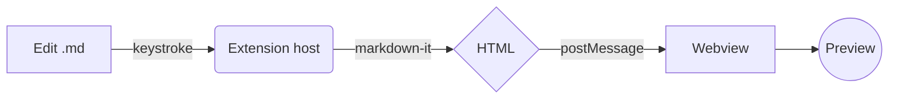
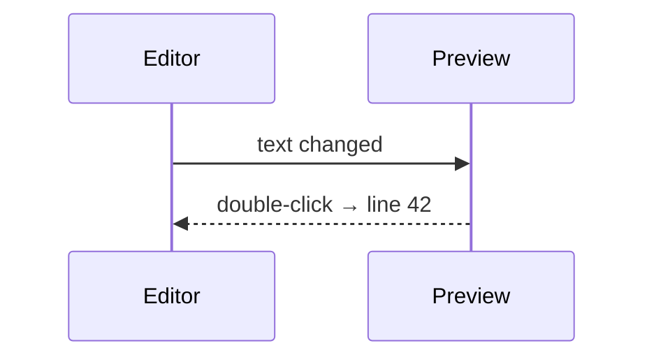

# Markdown Live Viewer

Edit this file and watch the preview update **as you type**. Double-click
anywhere in the preview to jump to that line in the source.

## Math

Euler's identity $e^{i\pi} + 1 = 0$ inline, and a display equation:

$$
\int_{-\infty}^{\infty} e^{-x^2}\,dx = \sqrt{\pi}
$$

## Mermaid





## Code

```ts
export function greet(name: string): string {
  // say hello
  return `Hello, ${name}!`;
}
```

## Lists and tables

- [x] Live refresh
- [x] Light / dark / auto theme
- [ ] Your next idea

| Feature | Shortcut |
|---|---|
| Open preview | <kbd>Ctrl</kbd>+<kbd>Alt</kbd>+<kbd>V</kbd> |
| Theme | toolbar button |

> Tip: set `mdViewer.refreshOn` to `save` for LaTeX Workshop-style refresh on save only.

Footnotes work too.[^1]

[^1]: Rendered with `markdown-it-footnote`.
